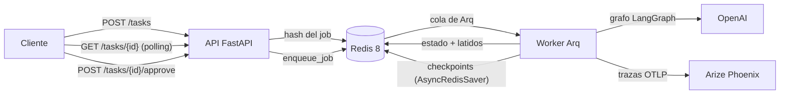
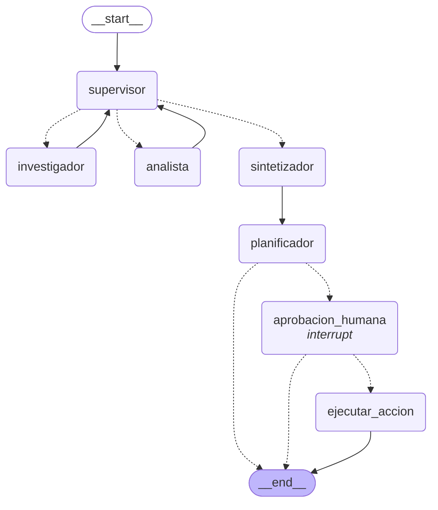

# API de producción y monitoreo activo

**Pre-entrega 7 — AI Engineering**

El orquestador multi-agente de la [Pre-entrega 6](https://github.com/PedroFassanelli/AI-Pre6) (soporte técnico de
**Nimbus Pagos**: supervisor + investigador + analista + sintetizador sobre LangGraph) se expone ahora como un
servicio:

- una **API REST asíncrona** (FastAPI) que encola la consulta y devuelve un `job_id` en milisegundos;
- un **worker** en proceso aparte (Arq) que corre el grafo en segundo plano;
- **Redis** como única fuente de estado: el estado de cada job, la cola y los **checkpoints de LangGraph**
  (`AsyncRedisSaver`);
- **trazas de cada ejecución en Arize Phoenix** (OpenInference), con costo por ejecución y latencia p95;
- un nodo **Human-in-the-loop** que pausa el grafo antes de cualquier acción con efectos secundarios y no avanza
  hasta recibir `POST /tasks/{id}/approve`.

```bash
docker compose up -d --build                 # redis + phoenix + api + worker
python scripts/prueba_carga.py               # 5 peticiones concurrentes
```

---

## Mapa de la consigna

| Requisito | Dónde | En una línea |
|---|---|---|
| Endpoint asíncrono que encola y devuelve un `job_id` | [app/main.py](app/main.py) → `POST /tasks` | 202 + `job_id`. Solo escribe Redis y encola: nunca ejecuta el grafo. |
| Consulta de estado sin bloquear | [app/main.py](app/main.py) → `GET /tasks/{id}` | Lee el hash del job con `redis.asyncio`. |
| Worker en segundo plano | [app/worker.py](app/worker.py) | Arq, proceso separado, hasta 10 tareas concurrentes por proceso. |
| Estado del job en Redis (`PENDING/RUNNING/FAILED/DONE`) | [app/jobs.py](app/jobs.py) | Transiciones atómicas (`WATCH`/`MULTI`) + `AWAITING_APPROVAL`. |
| `FAILED` ante una excepción | [app/worker.py](app/worker.py) → `correr_job` | `except Exception` y `except CancelledError`, más detección de worker caído. |
| Checkpoints de LangGraph en Redis | [app/graph.py](app/graph.py) → `abrir_checkpointer` | `AsyncRedisSaver` con `thread_id = job_id`. |
| Observabilidad (Phoenix / OpenInference) | [app/observability.py](app/observability.py) | `LangChainInstrumentor` + decorador `@trazar` + `session.id = job_id`. |
| Nodo HITL con `interrupt` + `POST /approve` | [app/hitl.py](app/hitl.py), [app/main.py](app/main.py) | Pausa obligatoria para toda acción con efectos. |
| 5 peticiones concurrentes | [scripts/prueba_carga.py](scripts/prueba_carga.py) | Resultado en [resultados/](resultados/). |
| Capturas de trazas, costo por ejecución y p95 | [screenshots/](screenshots/) | Ver [§ Lectura del dashboard](#lectura-del-dashboard). |
| `requirements.txt`, Docker Compose, `.env.example` | raíz del repo | — |

---

## Arquitectura



| Pieza | Por qué así |
|---|---|
| **API sin trabajo pesado** | Los endpoints solo hacen I/O asíncrono contra Redis (`redis.asyncio`, `arq.create_pool`). No hay ninguna llamada `sync` a una base o a un LLM dentro de un endpoint, así que el event loop no se bloquea nunca. En la prueba de carga, los 5 `POST` concurrentes respondieron en **21–52 ms** mientras el grafo tardaba 12–27 s. |
| **Worker en proceso aparte (Arq)** | El grafo también tiene CPU (BM25, chequeos, serialización): en otro proceso no le roba ciclos a la API. Escala por su cuenta (`docker compose up --scale worker=3`), y reiniciar la API no corta ninguna ejecución. Arq usa el mismo Redis, sin un broker más. |
| **Redis 8** | Trae incorporados los módulos de búsqueda y JSON que necesita `langgraph-checkpoint-redis`. Con AOF activado (`--appendonly yes`), los jobs y los checkpoints sobreviven a un reinicio del contenedor. |
| **Una sola imagen** | La API y el worker comparten el `Dockerfile`; cambia solo el comando. |

### El grafo

El orquestador de la Pre-entrega 6 queda intacto (todo pasa por el supervisor; la única salida de esa fase es el
sintetizador). Lo nuevo va **después** de la síntesis:



(Generado con `python -m app.cli diagrama` → [docs/grafo.mmd](docs/grafo.mmd).)

| Nodo | Qué hace |
|---|---|
| `planificador` | Le pregunta al modelo si la solicitud, además de una consulta, pide **ejecutar** algo. Si no hay pagos fallidos a la vista, ni siquiera lo consulta. |
| `aprobacion_humana` | `interrupt(...)` con todo lo que la persona necesita para decidir. El grafo queda pausado en Redis. |
| `ejecutar_accion` | La única escritura del sistema: programa los reintentos en la base. Verifica de nuevo que haya una aprobación positiva. |

---

## Ciclo de vida de un job

```
    PENDING ──► RUNNING ──┬──► DONE
       ▲                  ├──► FAILED              (excepción, timeout, worker caído)
       │                  └──► AWAITING_APPROVAL   (interrupt del nodo HITL)
       │                              │
       └──────── POST /approve ───────┘
```

Cada job es un hash `nimbus:job:<id>` en Redis (TTL de 24 h, configurable), más una lista `nimbus:job:<id>:nodos`
con el recorrido del grafo. El worker usa `astream(stream_mode="updates")`: cada nodo que termina actualiza
`nodo_actual` y el **latido** del job, así el cliente ve el progreso mientras hace polling.

**Ningún job queda colgado.** Es el error que la consigna pide evitar: el cliente haciendo polling para siempre.

| Qué falla | Qué pasa | Dónde |
|---|---|---|
| El grafo o el LLM lanzan una excepción | `except Exception` → `FAILED` con `{tipo, mensaje}` | `correr_job` |
| Arq corta por `job_timeout` o se apaga el worker | `except CancelledError` → `FAILED` y se re-lanza la cancelación | `correr_job` |
| El proceso muere sin poder avisar (kill -9, OOM) | El job deja de latir; la próxima lectura lo pasa a `FAILED` (`WorkerSinLatido`) | `AlmacenJobs.obtener` |
| No se puede encolar | El job se marca `FAILED` (`NoSePudoEncolar`) y la API responde 503 | `POST /tasks` |

Las tareas de Arq usan `max_tries=1`. Reintentar a ciegas un grafo que ya gastó tokens, o que ya escribió en la base,
no es una decisión que deba tomar la cola. Las transiciones son atómicas: un reintento de la cola sobre un job que ya
terminó no hace nada, y dos aprobaciones simultáneas del mismo job dan una 202 y una 409.

Evidencia de un `FAILED` real (worker con una API key inválida):
[resultados/failed-job.json](resultados/failed-job.json) (`PENDING → RUNNING → FAILED`, `OpenAIAuthenticationError`)
y [screenshots/08-job-failed-traza-con-error.png](screenshots/08-job-failed-traza-con-error.png).

---

## Human-in-the-loop

### Qué es "crítico"

El grafo de la Pre-entrega 6 solo leía. Acá se suma la primera acción que **escribe**: programar el reintento de
pagos fallidos, que en un sistema real dispara nuevos cobros sobre la tarjeta de un cliente. **Toda acción con
efectos secundarios es crítica**, sin excepciones: no hay forma de ejecutarla sin pasar por `aprobacion_humana`.

El modelo solo **propone** la acción. El código fija qué se toca: `validar_propuesta` descarta los pagos que el
investigador no consultó, los que no están fallidos y los de otro comercio, y después suma el monto. A quien aprueba
se le muestra **por qué** la acción es crítica:

```json
{
  "resumen": "Programar el reintento de 2 pago(s) fallido(s) de Viajes Aconcagua por CLP 63.000,00.",
  "pago_ids": ["pay_10502", "pay_10503"],
  "codigos_error": ["E5030"],
  "criticidad": [
    "Efecto secundario: genera nuevos intentos de cobro sobre los medios de pago de los clientes (escribe en reintentos_programados).",
    "Monto alto: CLP 63.000,00 (umbral CLP 10.000,00)."
  ],
  "descartados": []
}
```

Si los pagos tienen un código que la documentación marca como **no reintentable** (por ejemplo E4090), se agrega
una línea `ADVERTENCIA`. El dato sale de la misma tabla de `03-manejo-de-errores.md` que consulta el investigador.

### Cómo funciona la pausa

1. `aprobacion_humana` llama a `interrupt(solicitud)`. LangGraph guarda el checkpoint en Redis y la corrida termina.
2. El worker ve la interrupción, pasa el job a `AWAITING_APPROVAL` con la solicitud en `aprobacion_pendiente` y
   **libera el proceso**: no queda ningún hilo esperando.
3. `POST /tasks/{id}/approve` mueve el job de `AWAITING_APPROVAL` a `PENDING` (atómico) y encola la reanudación.
4. El worker retoma con `Command(resume=decision)` desde el checkpoint, en el mismo `thread_id`. Puede ser otro
   proceso, o el mismo después de un reinicio: el estado no vive en memoria.

Cualquier respuesta que no sea un `aprobado: true` explícito cuenta como rechazo. La escritura es idempotente
(`INSERT OR IGNORE` sobre `(pago_id, job_id)`): reanudar dos veces no programa dos veces el mismo cobro.

Evidencia: [resultados/hitl-job-5.json](resultados/hitl-job-5.json) (en pausa → 409 sobre un job que no estaba en
pausa → aprobado → `DONE`), [06](screenshots/06-hitl-sesion-pausa-y-reanudacion.png) y
[07](screenshots/07-hitl-traza-reanudacion.png).

---

## Observabilidad

[app/observability.py](app/observability.py) inicializa Phoenix con `phoenix.otel.register` (exportador OTLP/HTTP,
`BatchSpanProcessor`) y suma dos capas:

1. **`LangChainInstrumentor` (OpenInference)**: cada nodo del grafo, cada subgrafo ReAct, cada herramienta y cada
   llamada al LLM se vuelve un span, con los tokens de entrada y salida y el nombre del modelo. Con eso Phoenix
   **calcula solo el costo** de cada llamada y de cada traza.
2. **Decorador `@trazar`**: spans propios para lo que LangChain no ve. Son la raíz de cada traza (`tarea_nimbus`,
   tipo AGENT, con la pregunta como input y la respuesta como output) y la escritura en la base
   (`programar_reintentos`, tipo TOOL, con quién la aprobó).

Todas las trazas de un job llevan `session.id = job_id` y `metadata = {job_id, fase}`. Un job con aprobación
humana genera **dos trazas**, antes y después de la pausa, y en la vista *Sessions* aparecen juntas. Al apagarse,
el worker vacía el buffer de spans (`force_flush`) para no perder las últimas trazas.

---

## Prueba de carga: 5 peticiones concurrentes

```bash
python scripts/prueba_carga.py               # 5 consultas en paralelo; la 5.ª queda esperando aprobación
python scripts/prueba_carga.py --aprobar     # además, aprueba sola la acción crítica
```

El script lanza las 5 consultas con `asyncio.gather` sobre un único `httpx.AsyncClient`, hace polling de cada job y
deja el resultado completo en `resultados/carga-<fecha>.json`. Las cinco consultas son distintas: cuatro son solo
de consulta (con distinta cantidad de trabajo) y la quinta pide programar un reintento, que dispara el HITL.

Corrida del 05/10/2026 ([resultados/carga-20261005-093129.json](resultados/carga-20261005-093129.json)), con
`gpt-4o` en el supervisor y `gpt-4o-mini` en el resto:

```
 #  job_id                            estado             e2e (s) worker (s)  nodos
 1  1f0d07cb13cf4f41af9b14c91084cff9  DONE                  22.6       21.4  7
 2  85cc2d2b6b984be6b7af46784b1da8ae  DONE                  19.5       18.4  7
 3  d01a2d1cbe3140e2a1277a19efcaa066  DONE                  18.5       17.5  7
 4  90d02e0623b646cb9ac7ae7d565ad4c4  DONE                  12.3       11.8  5
 5  5b3b45a2c03240248398bf23f9ed7372  AWAITING_APPROVAL     27.7       26.5  9
------------------------------------------------------------------------------
POST (encolar):  p50 44.7 ms · p95 52.1 ms · máx 52.5 ms
Punta a punta:   p50 19.54 s · p95 26.64 s · máx 27.65 s
```

Las cinco corrieron **en paralelo** dentro de un mismo worker: la ronda completa tardó 27,7 s, lo mismo que la
consulta más lenta y no la suma de las cinco (≈ 100 s).

---

## Lectura del dashboard

Las métricas de esta sección salen de Phoenix, no del script: las calcula a partir de las trazas.

### Costo por ejecución y latencia p95

| Job | Consulta | Latencia (traza) | Tokens | **Costo** |
|---|---|---:|---:|---:|
| `1f0d07cb` | Bazar Pampa: código más frecuente + porcentajes | 21,39 s | 20.056 | US$ 0,01706 |
| `85cc2d2b` | Café Tortoni Centro: E4021 + porcentaje del monto | 18,38 s | 16.234 | US$ 0,01391 |
| `d01a2d1c` | Librería Ávila: código + porcentaje | 17,54 s | 16.013 | US$ 0,01443 |
| `90d02e06` | Bazar Pampa: E4290, ¿es reintentable? | 11,80 s | 10.258 | US$ 0,00981 |
| `5b3b45a2` | Viajes Aconcagua: E5030 + **programar reintento** | 26,51 s | 21.595 | US$ 0,02239 |
| | **Total de la corrida** | **p95 = 25,49 s** | 84.156 | **US$ 0,0776** (media **US$ 0,0155** por ejecución) |

- [01-trazas-costo-por-ejecucion.png](screenshots/01-trazas-costo-por-ejecucion.png): las 5 trazas con latencia,
  tokens y **total cost** de cada una.
- [03-latencia-p95.png](screenshots/03-latencia-p95.png): pestaña *Metrics*, tooltip del gráfico de latencia:
  p50 18,38 s · p75 21,39 s · p90 24,46 s · **p95 25,49 s** · p99 26,31 s.
- [04-costo-por-modelo.png](screenshots/04-costo-por-modelo.png): costo total y desglose por modelo.
- [02-traza-arbol-de-spans.png](screenshots/02-traza-arbol-de-spans.png): una traza abierta con el árbol completo
  (`tarea_nimbus → LangGraph → supervisor / investigador / … → ChatOpenAI / herramientas`).
- [05-sesiones-por-job.png](screenshots/05-sesiones-por-job.png): una sesión por job; el `session id` es el
  `job_id` que devolvió la API.

La reanudación del job HITL (traza aparte, en la misma sesión) costó US$ 0 y tardó 116 ms, porque solo escribe en
la base y no llama al modelo. La espera humana no cuenta como latencia del sistema: el worker no está ocupado
mientras el job está en pausa.

### Dónde se concentra la latencia y quién consume los tokens

Sumando los spans de cada nodo del grafo en las 5 trazas:

| Nodo | Tokens | % tokens | Tiempo total | % tiempo | Modelo |
|---|---:|---:|---:|---:|---|
| supervisor | 28.593 | 34 % | 27,6 s (15 decisiones, 1,8 s c/u) | 29 % | gpt-4o |
| investigador | 28.436 | 34 % | 33,0 s (6 rondas, 5,5 s c/u) | **35 %** | gpt-4o-mini |
| analista | 19.193 | 23 % | 17,4 s (4 rondas) | 18 % | gpt-4o-mini |
| sintetizador | 4.991 | 6 % | 10,8 s | 11 % | gpt-4o-mini |
| planificador | 2.943 | 3 % | 6,3 s | 7 % | gpt-4o-mini |

Lo que se lee:

1. **Mismos tokens, costo muy distinto.** Supervisor e investigador consumen lo mismo (34 % cada uno). Pero el supervisor corre en `gpt-4o`, unas 16 veces
   más caro por token, y explica **US$ 0,0687 de los US$ 0,0776 (89 %)** de la corrida. Es la primera palanca si
   hiciera falta bajar el costo: probar `gpt-4o-mini` en el supervisor y medir con las mismas 5 consultas si se
   degradan las decisiones. En la Pre-entrega 6 se degradaban, por eso quedó `gpt-4o`.
2. **La latencia se concentra en el investigador.** Cada ronda es un ciclo ReAct de 3–4 llamadas al modelo
   (buscar comercio → consultar pagos → buscar documentación → concluir), y son **secuenciales**. El supervisor
   decide rápido (1,8 s), pero decide 3 veces por consulta: es el costo fijo de la topología jerárquica.
3. **La consulta más lenta (job 5) es la que necesitó una segunda ronda del investigador.** La latencia de una
   consulta depende más de cuántas vueltas da el supervisor que del tamaño de la pregunta. El p95 (25,5 s) está
   dominado por esos casos con corrección.
4. **El planificador nuevo es barato:** 3 % de los tokens y 1,3 s por consulta, y en las consultas sin pagos
   fallidos ni siquiera llama al modelo.

---

## Cómo levantarlo

### Requisitos

- Docker (Docker Desktop en Windows/macOS).
- Una API key de **OpenAI** (o de Anthropic con `PROVEEDOR=anthropic`).
- Python **3.12** para correr la prueba de carga, los tests y las capturas desde la máquina local.

### 1. Configuración

```bash
cp .env.example .env          # Windows: Copy-Item .env.example .env
```

Completá `OPENAI_API_KEY`. El resto tiene valores por defecto razonables (ver los comentarios de
[.env.example](.env.example)).

### 2. Opción A: todo con Docker Compose (recomendado)

```bash
docker compose up -d --build
```

| Servicio | URL | Qué es |
|---|---|---|
| `api` | http://localhost:8000/docs | FastAPI (Swagger para probar los endpoints a mano) |
| `phoenix` | http://localhost:6006 | Dashboard de trazas (proyecto `nimbus-api`) |
| `redis` | `localhost:6379` | Redis 8 (estado, cola y checkpoints) |
| `worker` | — | Corre el grafo. Logs: `docker compose logs -f worker` |

Para escalar el worker: `docker compose up -d --scale worker=3`.

### 2. Opción B: Redis y Phoenix en Docker, la API y el worker locales

```bash
docker compose up -d redis phoenix

python -m venv .venv
.venv/bin/pip install -r requirements-dev.txt          # Windows: .venv\Scripts\pip ...

uvicorn app.main:app --port 8000                      # terminal 1
python -m app.worker                                  # terminal 2
```

El worker siembra la base de comercios y pagos al arrancar si no existe (`python -m app.cli sembrar` la regenera).

### 3. Probar

```bash
python scripts/prueba_carga.py
```

O a mano. En PowerShell, con UTF-8 para que los acentos lleguen bien:

```powershell
$cuerpo = @{ pregunta = "Viajes Aconcagua tuvo pagos fallidos por E5030. Explicame qué significa y programá el reintento de esos pagos." } | ConvertTo-Json
$job = Invoke-RestMethod -Method Post -Uri http://localhost:8000/tasks -ContentType "application/json; charset=utf-8" -Body ([Text.Encoding]::UTF8.GetBytes($cuerpo))
Invoke-RestMethod http://localhost:8000/tasks/$($job.job_id)          # repetir hasta AWAITING_APPROVAL
$ok = @{ aprobado = $true; revisor = "yo"; comentario = "E5030 es reintentable" } | ConvertTo-Json
Invoke-RestMethod -Method Post -Uri http://localhost:8000/tasks/$($job.job_id)/approve -ContentType "application/json" -Body $ok
```

### Endpoints

| Método | Ruta | Respuesta |
|---|---|---|
| `POST` | `/tasks` | **202** `{job_id, estado: "PENDING", url_estado}` + header `Location` |
| `GET` | `/tasks/{job_id}` | **200** estado completo: `estado`, `nodo_actual`, `nodos`, `aprobacion_pendiente`, `respuesta`, `resultado_accion`, `error`, duraciones · **404** si no existe |
| `POST` | `/tasks/{job_id}/approve` | `{aprobado, revisor, comentario}` → **202** (`PENDING`, reanudación encolada) · **409** si el job no está en `AWAITING_APPROVAL` |
| `GET` | `/tasks?estado=&limite=` | Últimos jobs |
| `GET` | `/health` | `{api: ok, redis: ok}` · **503** si Redis no responde |

### 4. Regenerar las capturas

```bash
python scripts/capturas.py              # usa el Edge instalado; --navegador chrome si no hay Edge
```

Las capturas del repo son de la corrida documentada arriba. Si se regeneran después de otras corridas, Phoenix
muestra también esas trazas (se puede acotar con `--rango 15m`).

---

## Tests

```bash
pip install -r requirements-dev.txt
pytest
```

**93 tests, sin red, sin Docker y sin API key.** Redis es `fakeredis`; la cola, un doble que anota lo encolado; los
modelos, el `LLMFalso` de guion fijo de las entregas anteriores; el checkpointer, un `InMemorySaver` (mismo
contrato que el `AsyncRedisSaver`).

| Archivo | Qué cubre |
|---|---|
| [tests/test_api.py](tests/test_api.py) | `POST` encola sin correr el grafo · 5 POST concurrentes → 5 jobs · el worker lleva a `DONE` · **excepción → `FAILED`** · **cancelación → `FAILED`** y se propaga · worker sin latido → `FAILED` · no se pudo encolar → 503 · un reintento de la cola no re-ejecuta · flujo HITL completo por la API · **doble aprobación concurrente → una 202 y una 409** · rechazo |
| [tests/test_hitl.py](tests/test_hitl.py) | La acción crítica pausa **antes** de escribir · aprobada escribe y lo dice · rechazada no escribe · respuesta ambigua = rechazo · solo sobreviven pagos consultados y fallidos · advertencia de código no reintentable · escritura idempotente |
| `tests/test_grafo.py`, `test_supervisor.py`, `test_chequeos.py`, `test_herramientas.py` | La suite de la Pre-entrega 6 (delegación, aislamiento de contexto, guardas contra el supervisor infinito, chequeos), adaptada al grafo nuevo. |

---

## Estructura

```
├── app/
│   ├── main.py            # FastAPI: POST /tasks · GET /tasks/{id} · POST /tasks/{id}/approve
│   ├── worker.py          # Arq: corre / reanuda el grafo y actualiza el estado (FAILED incluido)
│   ├── jobs.py            # estado de los jobs en Redis (transiciones atómicas, latidos)
│   ├── cola.py            # interfaz de la cola (Arq en producción, doble en los tests)
│   ├── graph.py           # orquestador M6 + planificador + HITL + AsyncRedisSaver
│   ├── hitl.py            # criticidad, interrupt, aprobación y ejecución de la acción
│   ├── observability.py   # Phoenix + OpenInference + decorador @trazar
│   ├── schemas.py         # modelos de la API
│   ├── config.py · state.py · cli.py
│   ├── agents/            # supervisor, investigador, analista, sintetizador (M6) + planner.py
│   ├── tools/             # herramientas de los especialistas (M6)
│   └── fuentes/           # corpus de nimbus-sdk (M4) y base de comercios y pagos (M5)
├── scripts/
│   ├── prueba_carga.py    # 5 peticiones concurrentes
│   └── capturas.py        # capturas del dashboard de Phoenix (Playwright)
├── screenshots/           # evidencia de observabilidad
├── resultados/            # salida de la prueba de carga, del HITL y del FAILED
├── tests/
├── docs/grafo.mmd
├── Dockerfile · docker-compose.yml
├── requirements.txt · requirements-dev.txt · .env.example
```

---

## Limitaciones conocidas

- **La calidad de las respuestas es la del orquestador de la Pre-entrega 6.** En algunas corridas, `gpt-4o-mini`
  resume mal un dato que sí recuperó. Por ejemplo, en el job 5 dice que la documentación no describe E5030, aunque
  la fila de la tabla llega en el resultado de `buscar_documentacion`. Esta entrega no toca los prompts de los
  especialistas: el foco es la infraestructura. Las trazas de Phoenix son, justamente, lo que permite encontrar
  estos casos.
- **Los umbrales de "monto alto" están en centavos sin distinguir moneda** (CLP 10.000 y ARS 10.000 cuentan
  igual). No cambia qué se aprueba, porque toda acción con efectos pide aprobación, pero sí la razón que se muestra.
- **El worker detecta su propia muerte por latido, no por heartbeat activo:** un job huérfano se marca `FAILED`
  recién cuando alguien lo consulta, pasado `SIN_LATIDO_SEGUNDOS` (6 min por defecto).
- **Phoenix corre sin autenticación** (configuración local de desarrollo). En un despliegue real va con
  `PHOENIX_ENABLE_AUTH` y una API key en el exportador.
